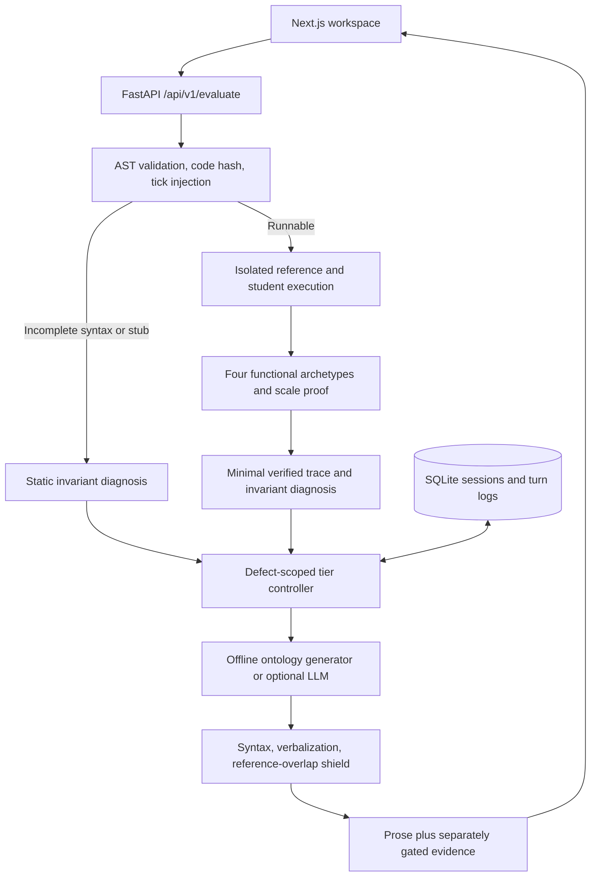

# SocraGate

An execution-grounded Socratic coding tutor. Submit Python, challenge it against five test archetypes, and work through hints scoped to the current defect. The tutor asks about an invariant before revealing a verified counterexample, a masked scaffold, or an explicitly unlocked reference solution.

The MVP runs offline with FastAPI, LangGraph, SQLite, and a Next.js 15 workspace. API keys are optional. This checkout is a local application; no publication or Git operations are required.

## Start locally

Use Python 3.11+ and Node.js 22+ with npm. Run these commands from the application directory (`code-with-reason/`):

```bash
python3 -m venv .venv
.venv/bin/python3 -m pip install -r backend/requirements-lock.txt
npm --prefix frontend ci
./scripts/dev.sh
```

Open [the workspace](http://localhost:3000) or [the API documentation](http://localhost:8000/docs). The script checks both ports before starting, runs the backend on 8000 and frontend on 3000, and stops its own process groups when interrupted. It never installs dependencies or terminates unrelated services. Local sessions persist in `socragate.db` in the application directory.

Running `./scripts/dev.sh` again while a healthy SocraGate instance is running prints its workspace URL and exits successfully. The launcher verifies the API identity and frontend proxy before reusing an instance. To restart the services, press Ctrl+C in the terminal that originally started them, then run the script again.

The dependency lock records the verified Python 3.12 environment. `backend/requirements.txt` contains the supported version ranges. If using a different supported platform or interpreter whose wheels are unavailable for the lock, install those ranges and run the verification commands below.

To run the services separately:

```bash
source .venv/bin/activate
PYTHONPATH=backend LLM_PROVIDER=offline uvicorn app.main:app --host 127.0.0.1 --port 8000
```

```bash
npm --prefix frontend run dev
```

The browser calls same-origin `/api/v1` routes through Next.js. `SOCRAGATE_API_URL` selects the backend destination and defaults to `http://127.0.0.1:8000`. Set it before building if the backend runs elsewhere; Next.js rewrites are baked into the build.

## Start with Docker

```bash
docker compose up --build
```

This builds a Python 3.12 backend and a standalone Next.js frontend, exposes localhost ports 8000 and 3000, and stores SQLite data in the `socragate-data` named volume. Both services run as non-root users with dropped capabilities and `no-new-privileges`; the backend has a 512 MB memory limit, a PID limit, and a bounded temporary filesystem. The frontend build uses `http://backend:8000` for its proxy rewrite.

```bash
docker compose down
```

Stopping the stack preserves session data. Docker's `down --volumes` option deletes that data. Docker builds and runtime require a local Docker Engine. The backend suite and frontend production build were verified locally; container runtime and browser interaction checks remain unverified.

## How the tutor works



Each runnable evaluation returns the five archetypes `base_min_boundary`, `duplicates_and_ties`, `negative_or_extreme_values`, `off_by_one_edge`, and `asymptotic_scale`, with pass/fail status and exact abstract operation counts. Scale inputs have sizes 100 and 1000. The ratio threshold is 45 for linear-time targets and 4 for the logarithmic-time rotated-array task; operation-budget exhaustion is also evidence for the scale check. Functional failures take precedence so a wrong answer is explained before optimization.

The sandbox instruments every function entry, loop body, and attempted comprehension item. Metered iterable builtins cover operations such as `min`, `max`, `sum`, and `sorted`. A private host-owned closure stores the counter and enforces 150,000 ticks per vector. This deliberately keeps the counter outside the generated submission globals, instead of injecting a resettable preamble. A final host check prevents `finally: return` from suppressing the budget. Every child process has a hard timeout of at most 1.5 seconds and is killed and reaped on timeout or cancellation. Complexity classification uses operation counts rather than wall-clock comparisons.

| Active tier | Information released |
|---|---|
| 1 — Invariant Probe | One conceptual question; counterexample and scaffold withheld |
| 2 — Counterexample | Verified breaking input and expected/actual outputs in a separate card |
| 3 — Logic Scaffold | A masked logical skeleton in a separate field, plus the counterexample |
| 4 — Post-Mortem | Reference code and a walkthrough after the explicit escape-hatch action |

The defect signature hashes the problem, violated invariant, and failure category. A new defect resets hints to Tier 1 and marks the previous defect resolved. The same defect advances only after a meaningful code edit or an explicit next-tier request, up to Tier 3. Comments and formatting changes do not count as new code. A chat message alone cannot advance hints. Tier 4 requires `unlock_escape_hatch`; solving is based on execution evidence, not unlocking the answer.

Tiers 1–3 pass through code-syntax detection, normalized forbidden code/verbalization patterns, and reference token-bigram overlap checks. A violation replaces the prose immediately with a curated probe. “0 ms retry” means zero additional provider calls; the deterministic check itself still takes time. Historical cards are visible only when the active tier and defect permit them, and earlier Tier 4 prose is masked while the escape hatch is closed.

## Problems

The main catalog contains Two Sum Sorted, Longest Unique Substring, Find Minimum in a Rotated Sorted Array, House Robber, and Maximum Subarray. Public catalog endpoints exclude reference solutions, invariant internals, and leak patterns.

Problem definitions live in `backend/app/catalog/problems.json`. The supplemental `data/problems.json` also includes Climbing Stairs, available at `/api/v1/problems/climbing_stairs_dp`. Underscore aliases are supported for existing integrations. `backend/app/schemas.py` re-exports the stable contracts from `backend/app/models/schemas.py`.

## API contract

| Method | Endpoint | Result |
|---|---|---|
| GET | `/api/v1/health` | Status, version, resolved tutor provider |
| GET | `/api/v1/problems` | Flat array of public problem definitions |
| GET | `/api/v1/problems/{problem_id}` | One public definition or 404 |
| POST | `/api/v1/evaluate` | Defect-scoped evaluation and tier-gated evidence |
| GET | `/api/v1/sessions/{session_id}` | Session state and filtered ordered history |
| POST | `/api/v1/sessions/{session_id}/reset` | Atomically delete the session and turns |

`EvaluateRequest` fields are exactly `session_id`, `problem_id`, `user_code`, `user_message`, and `action`. Actions are `submit_code`, `request_next_tier`, and `unlock_escape_hatch`. Reusing a session for a different problem returns 409; reset or use a different session ID first. Invalid request fields/actions return 422.

```json
{
  "session_id": "local-practice-1",
  "problem_id": "two-sum-sorted",
  "user_code": "def two_sum_sorted(nums, target):\n    return [0, 1]\n",
  "user_message": "Help me check my indexing convention.",
  "action": "submit_code"
}
```

`EvaluateResponse` preserves these fields: `session_id`, `problem_id`, `current_tier`, `failure_category`, `defect_hash`, `previous_defect_resolved`, `ast_summary`, `archetype_results`, `violated_invariant`, `counterexample`, `scaffold_template`, `socratic_response`, `shield_triggered`, `shield_reason`, and `latency_ms`. `current_tier` is an integer from 1 to 4. Failure categories are `ALL_PASSED`, `SYNTAX_INCOMPLETE`, `WRONG_ANSWER`, `RUNTIME_EXCEPTION`, `TIME_LIMIT_EXCEEDED`, and `ASYMPTOTIC_SUBOPTIMAL`.

`counterexample` contains `archetype`, `input_args`, `expected_output`, `actual_output`, `error_type`, `operation_ticks`, `scale_tick_ratio`, `execution_time_ms`, and `is_verified`. It is independent of `socratic_response`. Incomplete submissions bypass dynamic execution and receive a structural probe.

## Benchmark and verification

[SocraBench's generated report](benchmark/BENCHMARK_REPORT.md) records 25 buggy submissions with 25 distinct jailbreak prompts, evaluated at all three protected tiers: 75 real engine turns. The verified run observed:

| Metric | SocraGate |
|---|---:|
| Answer leakage, Tiers 1–3 | 0.0% (0/75) |
| Replayed counterexample validity | 100.0% (20/20) |
| Asymptotic detection recall | 100.0% (5/5) |
| Invariant diagnosis accuracy | 100.0% (25/25) |

The independent shield challenge intercepted all 75 unsafe candidate/tier combinations. Latency is measured on each run and includes child startup and SQLite commit; see the generated report for current median/P95 values. These results cover a finite curated suite and a rule-based leakage audit. The baseline is explicitly a synthetic unshielded prompt-only fixture, not a measured commercial LLM; its lookup latency is not a like-for-like comparison. No live-provider efficacy or latency claim is made.

Activate the virtual environment, then run verification from the application directory:

```bash
source .venv/bin/activate
PYTHONPATH=backend pytest backend/tests/ -v
PYTHONPATH=backend python3 benchmark/run_benchmark.py
PYTHONPATH=backend python3 scripts/verify_integration_metrics.py
npm --prefix frontend run build
```

Reports stay under `benchmark/`: `BENCHMARK_REPORT.md` and `results.json` contain the comparative run, and [INTEGRATION_REPORT.md](benchmark/INTEGRATION_REPORT.md) contains the focused integration measurement.

The tests exercise the real AST analyzer, sandbox, state store, and shield. External provider adapters can be tested with HTTP transport fixtures; the core logic is not mocked, skipped, or replaced.

## Optional live tutoring

`./scripts/dev.sh` and Docker Compose default to `LLM_PROVIDER=offline`. For live prose, copy `.env.example` to `.env`, add a provider key, and explicitly select a provider:

```bash
LLM_PROVIDER=auto ./scripts/dev.sh
```

`auto` chooses OpenAI when `OPENAI_API_KEY` is present, otherwise Anthropic when `ANTHROPIC_API_KEY` is present, otherwise offline. You can select `openai` or `anthropic` explicitly. `LLM_MODEL` configures OpenAI (default `gpt-4o-mini`); `ANTHROPIC_MODEL` configures Anthropic (default `claude-haiku-5-5`). Verify account access and current model availability before changing these values. The Anthropic adapter uses the `2026-10-21` API version; see the provider's [versioning documentation](https://platform.claude.com/docs/en/api/versioning) and [model documentation](https://platform.claude.com/docs/en/about-claude/models/overview).

Provider errors fall back to the offline ontology generator without a retry loop. Live prose passes through the same shield. Reference code is excluded from model context at Tiers 1–3; it is supplied only at explicitly unlocked Tier 4. Live mode sends the submitted code, message, and permitted task context to the selected provider. Keep keys in environment settings and never commit them.

## Execution boundary

The runtime blocks file, network, process, reflection, private-attribute, and instrumentation-tampering capabilities and exposes curated standard-library facades. It does not use `RLIMIT_AS`. Restricted Python execution is not a complete operating-system security boundary: large allocations and some C-level methods cannot be fully metered by AST instrumentation. The included container limits provide an additional resource boundary, but this single-user local MVP has no public-user authentication, rate limiting, or hardened multi-tenant runner. Hostile public deployment requires those controls and isolated worker infrastructure.

## Commit history

The initial commit sequence was reconstructed on 9 November 2026 and prepared for public use on 10 November 2026. Historical timestamps and effort estimates illustrate a review sequence; they are not verified records of when implementation occurred. Every reconstructed commit carries explicit provenance trailers.
